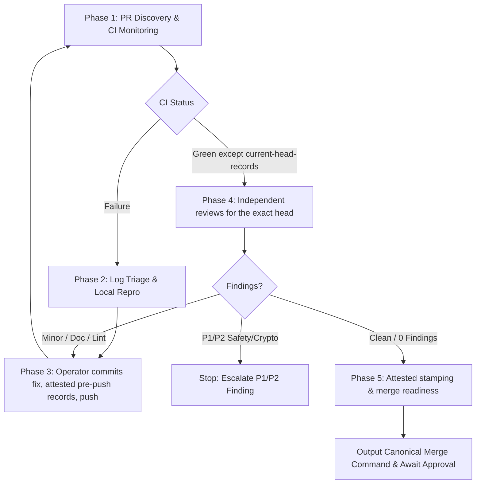

Invoke `$ci-heal`. Read [AGENTS.md](../../../AGENTS.md) first. Its one standing exception is the
authorization stated in the boundary below; this workflow grants nothing beyond it. Canonical
skills live under `.agents/skills/`; hooks enforce local policy.

# ci-heal — Post-Push CI Monitoring, Failure Reproduction & Merge-Readiness Gate

This skill orchestrates the post-push CI lifecycle for `tesla-key-esp32`. It monitors GitHub
Actions for an open pull request, extracts failed logs, runs host preflights, pushes a fix
commit that the operator already made, and
verifies that the PR reaches a mergeable state with current gate records.

> **Authorization and Safety Boundary.** The user's own invocation of this skill (not an agent's or
> another workflow's decision to run it) is the user's explicit authorization, recorded as a
> standing exception in [AGENTS.md](../../../AGENTS.md), for running the repository
> verification scripts, editing the PR body's gate records **from explicit attestations**, and
> pushing an already-committed fix to the active PR branch up to the iteration limit. It does
> **not** authorize authoring commits, running or simulating a review, modifying `partitions.csv`,
> Secure-Boot keys, NVS layouts, or PSA crypto seams. Any P1/P2 security, signing, NVS, pairing,
> partition, or vehicle-safety finding is a stop condition. Executing the canonical squash merge
> requires the user's separate explicit authorization for this exact PR; pass `--auto-merge` only
> after that authorization. The flag executes the merge; it does not grant it.

## What the script guarantees (and what it refuses)

`scripts/ci-heal.sh` is deliberately conservative; its self-test (run by `scripts/test-pr-gates.sh`)
drives the real flow with stubbed `git`/`gh` and pins every refusal below. The start-up checks (a
missing or incomplete `pr-gate-lib.sh`, a non-numeric PR number) run before any stub can apply, so
the self-test exercises them on an isolated copy of the script and through its `main` function.

- **It never commits.** A fix must already be committed by the operator (English message, no
  private identifiers). An uncommitted working tree stops the run. ci-heal only pushes when local
  `HEAD` descends from the PR head, and never rewrites history.
- **It never invents a review.** A gate record is written only from `--attest <gate>=<evidence>`,
  where the evidence names the independent review that was actually completed for the exact head
  being stamped (for example a report path and its finding count). A syntax or configuration
  check such as `node tools/agent-config/check.mjs` is **not** a `$skill-audit`, and a green CI
  run is **not** a `$project-review`. Without an attestation the run ends with exit code 3 and the
  exact `--attest` flags that are missing.
- **Readiness is about one commit.** Merge-readiness stamping, `READY FOR MERGE` and `--auto-merge` all require
  green CI on the PR head, local `HEAD` equal to that head, a clean working tree, the PR reporting
  `MERGEABLE`, and an unchanged head immediately before the body edit. Green CI means, for the
  latest run of every check at that head (earlier runs, such as the records failure before
  stamping, are superseded), a successful `build` and no other check queued, running, cancelled or
  failed (skipped and neutral checks are fine, but a skipped or missing `build` never counts).
  Any mismatch stops the run before any merge-readiness record is stamped. `pr-policy /
  current-head-records` validates the records this workflow stamps, so a failure of that check
  alone counts as "records pending", not as red CI. If local `HEAD` then carries a committed review
  fix that descends from the PR head, ci-heal pushes it through Phase 3 and stops with exit code 3:
  merge records for the new head need fresh reviews and a new run. After stamping, `READY FOR MERGE` and
  `--auto-merge` also require a new run of that check to pass and every check to be green on the
  unchanged head. A failed stamp, push or merge stops the run. Phase 3 pre-push records instead
  attest the independently reviewed local fix commit before it has green remote CI.
- **Relevance matches the merge hook.** The gates a PR needs come from the same GitHub-side
  changed-file list and the same shared predicates (`gate_feature_docs_relevant`,
  `gate_vehicle_command_relevant`, `gate_is_renovate_maintenance`) as
  `tools/agent-hooks/require-pr-gates.sh`. If that list cannot be read, no merge-readiness record is stamped.
- **It fails closed on its own inputs.** A missing or incomplete `tools/agent-hooks/pr-gate-lib.sh`,
  an unknown gate name, a non-numeric PR number or a non-40-hex head is a hard stop. The merge
  runs as a direct `gh` invocation with validated arguments, never through `eval`.

Exit codes: `0` ready or diagnosed, `1` blocked or failed, `2` usage/configuration, `3` gate
records withheld.

---

## 5-Phase Workflow



---

## Phase 1: PR Discovery & CI Monitoring

1. **Detect PR Context**:
   ```bash
   gh pr view --json number,headRefName,headRefOid
   ```
   The current branch (`git rev-parse --abbrev-ref HEAD`) must be the PR's `headRefName`; the
   script refuses otherwise.
2. **Watch CI Workflow Status**:
   ```bash
   gh pr checks <numeric-pr> --watch
   ```

---

## Phase 2: Failure Analysis & Local Reproduction

If any CI check fails, `ci-heal.sh` prints the failed job logs. It runs all five host preflights
below, first repeating the one matching the current failure category when supported:

- **Agent configuration / rules**: `./tools/agent-config/selftest.sh`
- **Repository linter / syntax**: `./scripts/repo-lint.sh`
- **Host logic / mock tests**: `./scripts/run-mock-tests.sh`
- **Build contracts / pins / partition**: `./scripts/test-build-contracts.sh`
- **PR gate matcher**: `./scripts/test-pr-gates.sh`

The operator must separately reproduce failures outside these automatic host preflights:

- **Tesla BLE integration harness**: `./scripts/test-tesla-ble-harness.sh`
- **Linux sanitizers**: `./scripts/run-sanitizer-tests.sh`
- **Pinned ESP-IDF compilation**: use `./scripts/idf-docker.sh` and the affected target's
  build entry point from [Development](../../../docs/DEVELOPMENT.md).

A failure that cannot be identified from the check rollup (pending, cancelled, API error) is not
treated as fixable; the script stops and points at `gh pr checks`.

---

## Phase 3: Fix, Pre-Push Records & Push

1. **Commit a scoped fix under its own authorization.** The `$ci-heal` invocation covers only the
   attested record edits and the push; editing and committing the fix need the user's separate
   implementation and commit authorization. Keep the fix minimal and within
   [`docs/ARCHITECTURE.md`](../../../docs/ARCHITECTURE.md) and [`AGENTS.md`](../../../AGENTS.md).
   Do not use `git add -A`; stage only the files the fix touches.
2. **Obtain independent pre-push reviews for the new commit.** The push hook requires current
   `$skill-audit` and `$pr-hygiene` records for the exact commit being pushed. A reviewer other
   than the fix's author runs both (read-only) against that commit; ci-heal only records them.
3. **Re-run ci-heal with the attestations:**
   ```bash
   scripts/ci-heal.sh --pr <numeric-pr> \
     --attest skill-audit="<report reference, 0 findings>" \
     --attest pr-hygiene="<report reference, clean>"
   ```
   ci-heal stamps both records for the local `HEAD`, pushes the branch, waits until GitHub reports
   that commit as the PR head, and resumes monitoring; after a review fix it stops there instead. A
   later commit stales every record and needs fresh attestations.
4. **Iteration Guard.** Iterations beyond the limit (default 3, maximum 5) stop the run. A run
   pushes at most one fix: after it the local `HEAD` is the PR head, so a red re-check stops with
   "nothing to push" until you commit the next fix and re-run.

---

## Phase 4: Independent Reviews for the Exact Head

Once every check except `pr-policy / current-head-records` is green for the current commit (that
check validates the records this workflow stamps), complete the reviews that produce the gate records:

- `$skill-audit` — `./tools/agent-config/selftest.sh` supports it but does not replace it.
- `$pr-hygiene` — English content and no private identifiers in commits, PR text and touched docs.
- `$project-review` — system-wide coherence and contracts.
- `$feature-docs` — when the feature catalog surface changed (`gate_feature_docs_relevant`).
- `$vehicle-command-audit` — when vehicle-command/BLE paths changed
  (`gate_vehicle_command_relevant`; `./scripts/test-tesla-ble-harness.sh` supports it).

The four reviewer roles (`agent_config_reviewer`, `doc_drift_checker`, `heap_safety_reviewer`,
`multi_target_build_reviewer`) may be consulted. A P1/P2 security, safety, crypto, signing, NVS,
pairing or partition finding is a stop condition: escalate to the user.

---

## Phase 5: Attested Stamping & Merge Readiness

```bash
scripts/ci-heal.sh --pr <numeric-pr> \
  --attest skill-audit="<evidence>" --attest project-review="<evidence>" \
  --attest pr-hygiene="<evidence>"    # plus feature-docs / vehicle-command-audit when relevant
```

With every other check green, `MERGEABLE`, local `HEAD` equal to the PR head and every needed gate
attested, ci-heal stamps the records, waits until a new `current-head-records` run passes and
every check is green on the same head, and only then prints the exact, single canonical squash
merge command:

```bash
gh --repo github.com/0Bu/tesla-key-esp32 pr merge <PR> --match-head-commit <FULL_40_HEX_HEAD_SHA> --squash
```

Ask the user for explicit confirmation before executing the merge, or pass `--auto-merge` only when
the user has authorized the merge for this exact PR. `--dry-run` diagnoses without stamping,
pushing or merging and is incompatible with `--auto-merge`.

---

## Phase 6: Evaluation, Scorecard & Run Statistics

Paths that reach `evaluate_and_optimize()` report the following; some early refusals return
before evaluation:

1. **Report Run Metrics**: iterations vs limit, duration and the failure category (`repo-lint`,
   `agent-config`, `mock-tests`, `pr-gates`, `build-contracts`, `sanitizers`, `compiler`,
   `general-ci-failure`, or `unidentified` when no failed check could be read).
   Fix-footprint counters remain unmeasured zero placeholders.
2. **Present Scorecard** summarizing the outcome and root cause.
3. **Persist Statistics (`.tmp/ci-heal-cache.json`)**: category frequencies and recent runs are
   stored locally for reporting. They do not select or prioritize checks. The cache is untracked;
   preflight priority comes from the current failure category.
